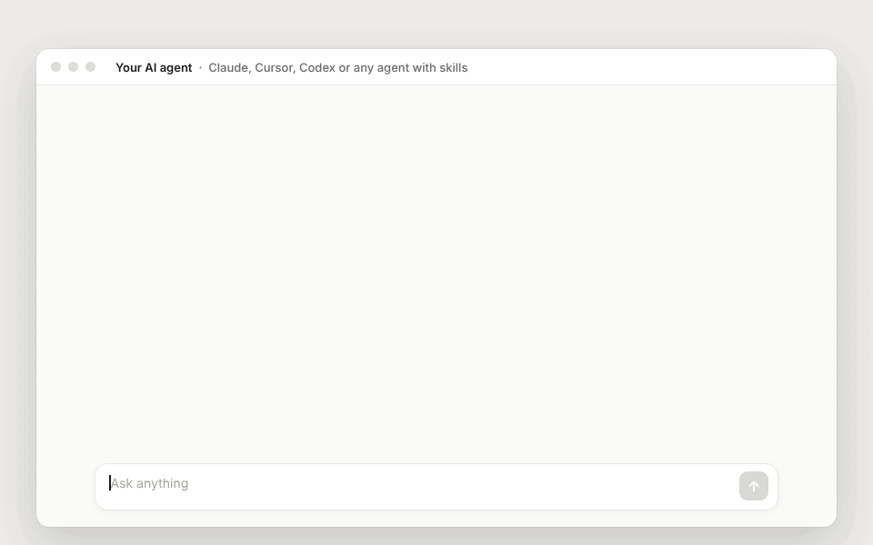

<p align="center">
  <a href="https://www.replai.now/?utm_source=github&utm_medium=readme&utm_campaign=shopify-skills">
    
  </a>
</p>

# Skills For Real Shopify Stores

Free AI skills that do the store jobs you keep putting off: calming down angry customers, writing product pages that sell, turning mannequin photos into catalog shots, finding your real profit, seeing where cash on delivery orders fail, and knowing what to reorder.

They work in Claude (web and desktop app), Claude Code, and most other AI agents. Each skill is one short file you can read in two minutes, so you can see exactly what it does and change it to suit your store.

Made by [ReplAi](https://www.replai.now/?utm_source=github&utm_medium=readme&utm_campaign=shopify-skills), the AI support agent for Shopify stores.

## See It Work

<p align="center">
  
</p>

One prompt, four setup questions, then the answer and a dashboard. The store in this demo is made up. The numbers are what [`cod-rto-analysis`](./skills/operations/cod-rto-analysis/SKILL.md) really worked out from its orders export.

## Fastest Start: Paste One Prompt

Copy this into your AI agent. Change the part after "then" to the job you want done, and attach your file if the job needs one.

```text
Install the free Shopify skills from https://github.com/ReplAi-Now/shopify-skills, then show me where my cash on delivery orders fail and what it costs me.
```

Agents that can run commands (Claude Code, Claude Cowork, Cursor, Codex) install the skills themselves. In the Claude web or desktop app, add the skills with the 2-minute setup below first, then paste only the part after "then".

<details>
<summary><strong>A ready prompt for every skill</strong></summary>

| Skill | Paste after "then" | Have ready |
|---|---|---|
| angry-customer-reply | help me reply to this angry customer: [paste their message] | Their message, the order, what you are willing to offer |
| product-descriptions | write a product description and SEO title for this product: [details or link] | Product facts, a link or photos |
| catalog-photoshoot | turn the photos in this folder into catalog photos on one model. | Magnific or Higgsfield connected, your product photos |
| shopify-catalog-upload | upload the products in this folder to my store. Prices and stock are in this sheet. | Shopify connected with write access, photos, prices, sizes, stock |
| size-chart-builder | make a size chart in English and Arabic from this spec sheet. | Your measurements or the supplier's sheet |
| conversion-optimiser | audit my store [your store link] for what stops people buying. | Your store link |
| true-profit | show me which products really make money after ads, shipping and returns. | Orders export or Shopify connected, product costs, ad exports |
| cod-rto-analysis | show me where my cash on delivery orders fail and what it costs me. | Orders export or Shopify connected. Courier exports help. |
| returns-reason-analysis | tell me why customers return or exchange, and which products to fix. | Orders export or Shopify connected |
| demand-planner | tell me what to reorder this week, and how much. | Orders and stock exports or Shopify connected, unit costs, supplier lead times |
| dead-stock-clearance | find the stock that is not selling and how much cash is stuck in it. | Orders, products and stock exports or Shopify connected, unit costs |
| weekly-kpi-digest | give me last week's store digest, and send it every Saturday. | Orders export or Shopify connected |

</details>

## Installation (2-minute setup)

Pick one route. Installing the same skills twice gives you duplicates.

<details open>
<summary><strong>Claude (web or desktop app)</strong></summary>

1. Download the skills you want:
   - [angry-customer-reply.zip](https://github.com/ReplAi-Now/shopify-skills/releases/latest/download/angry-customer-reply.zip)
   - [product-descriptions.zip](https://github.com/ReplAi-Now/shopify-skills/releases/latest/download/product-descriptions.zip)
   - [catalog-photoshoot.zip](https://github.com/ReplAi-Now/shopify-skills/releases/latest/download/catalog-photoshoot.zip)
   - [shopify-catalog-upload.zip](https://github.com/ReplAi-Now/shopify-skills/releases/latest/download/shopify-catalog-upload.zip)
   - [size-chart-builder.zip](https://github.com/ReplAi-Now/shopify-skills/releases/latest/download/size-chart-builder.zip)
   - [conversion-optimiser.zip](https://github.com/ReplAi-Now/shopify-skills/releases/latest/download/conversion-optimiser.zip)
   - [true-profit.zip](https://github.com/ReplAi-Now/shopify-skills/releases/latest/download/true-profit.zip)
   - [cod-rto-analysis.zip](https://github.com/ReplAi-Now/shopify-skills/releases/latest/download/cod-rto-analysis.zip)
   - [returns-reason-analysis.zip](https://github.com/ReplAi-Now/shopify-skills/releases/latest/download/returns-reason-analysis.zip)
   - [demand-planner.zip](https://github.com/ReplAi-Now/shopify-skills/releases/latest/download/demand-planner.zip)
   - [dead-stock-clearance.zip](https://github.com/ReplAi-Now/shopify-skills/releases/latest/download/dead-stock-clearance.zip)
   - [weekly-kpi-digest.zip](https://github.com/ReplAi-Now/shopify-skills/releases/latest/download/weekly-kpi-digest.zip)
2. In Claude, open [Customize > Skills](https://claude.ai/customize/skills) and upload each zip. Don't unzip it first.
3. Check each skill is switched on.

Done. Next time you paste in an angry email, ask for a product description or ask what to reorder, Claude picks up the right skill by itself.

Skills need a paid Claude plan (Pro, Max, Team or Enterprise).

</details>

<details>
<summary><strong>Claude Code</strong></summary>

```bash
claude plugin marketplace add ReplAi-Now/shopify-skills
claude plugin install shopify-skills@replai
```

To pick up new skills later, run `claude plugin marketplace update replai`.

</details>

<details>
<summary><strong>Any other agent</strong> (Cursor, Codex, Windsurf and more)</summary>

```bash
npx skills@latest add ReplAi-Now/shopify-skills
```

To update, run `npx skills@latest update`, and re-run `add` to pick up new skills.

</details>

## Why These Skills Exist

Running a store means doing ten jobs at once, with no time to do any of them well. AI can help, but a blank chat box gives you generic answers. A skill gives the AI a proven way to do one job, so you get the same good result every time without writing a long prompt.

### #1: Angry Emails Eat Your Morning

> "Your most unhappy customers are your greatest source of learning."
>
> Bill Gates, Business @ the Speed of Thought

**The Problem**: One furious email can cost you an hour. You draft, delete, redraft, and still worry you sound defensive. Reply badly and it becomes a chargeback or a one-star review.

**The Fix**: [`angry-customer-reply`](./skills/support/angry-customer-reply/SKILL.md). Paste the email, add the order details, and say what you're willing to offer. You get a short, calm reply that fixes the problem, sticks to your policy, and never promises anything you didn't approve.

### #2: Product Pages That Don't Sell

> "On the average, five times as many people read the headline as read the body copy."
>
> David Ogilvy, Confessions of an Advertising Man

**The Problem**: Most product descriptions are a supplier's spec sheet pasted in, or a paragraph of "premium quality" that says nothing. Shoppers skim, don't find their answer, and either leave or email you to ask.

**The Fix**: [`product-descriptions`](./skills/store/product-descriptions/SKILL.md). Give it the product facts and it writes a description shoppers can take in at a glance: an opening line about what they get, benefit-first bullet points, and the details people usually email to ask about. It also writes the SEO title and meta description. It never invents specs.

## Reference

### Support

Skills for talking to customers.

- **[angry-customer-reply](./skills/support/angry-customer-reply/SKILL.md)**: Draft a calm, on-policy reply to an upset customer email, chat message or review.

### Store

Skills for your storefront.

- **[product-descriptions](./skills/store/product-descriptions/SKILL.md)**: Write or rewrite product descriptions that sell, plus the SEO title and meta description.
- **[catalog-photoshoot](./skills/store/catalog-photoshoot/SKILL.md)**: Turn mannequin, flat lay or raw product photos into consistent catalog photos with an AI model (Magnific or Higgsfield), with an automatic quality check.
- **[shopify-catalog-upload](./skills/store/shopify-catalog-upload/SKILL.md)**: Upload finished photos to Shopify as complete listings (variants, SKUs, swatches, copy), or add new colours to existing products.
- **[size-chart-builder](./skills/store/size-chart-builder/SKILL.md)**: Build accurate size charts in English or Arabic from supplier sheets or measurements, ready for the product page.
- **[conversion-optimiser](./skills/store/conversion-optimiser/SKILL.md)**: Audit your store for what stops people buying, then fix it on a theme copy with your OK.

### Operations

Skills for the numbers behind the store. Each works from the Shopify connector or from your Shopify CSV exports.

- **[true-profit](./skills/operations/true-profit/SKILL.md)**: Real profit per product and order after ads, shipping, COD fees, failed deliveries and returns.
- **[cod-rto-analysis](./skills/operations/cod-rto-analysis/SKILL.md)**: Find where cash on delivery orders fail (governorate, courier, product, customer) and what it costs.
- **[returns-reason-analysis](./skills/operations/returns-reason-analysis/SKILL.md)**: Find why customers return or exchange (English, Arabic and Franco text) and which products to fix.
- **[demand-planner](./skills/operations/demand-planner/SKILL.md)**: When to reorder each variant and how much, balancing stockouts against cash tied up in stock.
- **[dead-stock-clearance](./skills/operations/dead-stock-clearance/SKILL.md)**: Find slow and dead stock, the cash stuck in it, and a clearance plan you approve.
- **[weekly-kpi-digest](./skills/operations/weekly-kpi-digest/SKILL.md)**: A one-page weekly snapshot of the store with three things to act on, on a schedule.

### Coming Soon

- **returns-policy**: Write a clear returns and refunds page from a few questions.
- **faq-from-tickets**: Turn your past customer emails into an FAQ page.
- **review-replies**: Reply to good and bad reviews in your brand voice.
- **abandoned-cart-emails**: Write an abandoned checkout email sequence.
- **collection-seo-audit**: Check a collection page for the SEO basics and fix what's missing.

To hear when they land, watch this repo (Watch > Custom > Releases).

## Setup And Your Data

The store and operations skills ask a few setup questions the first time you use them (your currency, costs, couriers, photo style) and save the answers in a `replai-setup` folder next to your files, so you only answer once. In chat apps without files, the skill gives you a short setup card to paste next time.

Your data stays between you, your AI and the tools you connected. The skills only read your store unless you approve an exact list of changes first, and nothing is ever deleted.

## Feedback

Skill doing something wrong? [Open an issue](https://github.com/ReplAi-Now/shopify-skills/issues/new) with what you pasted in, what it wrote, and what you expected instead. Ideas for new skills are welcome too.

---

Every question your product page answers is one less support email. For the ones that still arrive, [ReplAi](https://www.replai.now/?utm_source=github&utm_medium=readme&utm_campaign=shopify-skills) answers them for you, using your own store policies.
